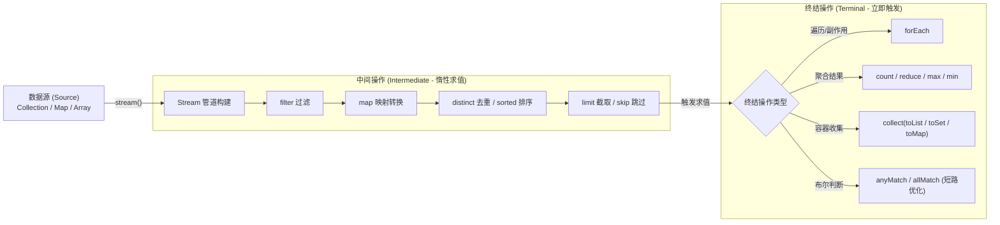

# Java Stream 流式编程体系深度精讲

本模块为 Java 8+ Stream 流式处理体系的系统化学习与实战总结，配套模块源码均位于当前包下，以 [`Test.java`](Test.java) 为主执行入口。

---

## 1. 模块代码导航

| 模块文件 | 对应课程 | 核心教学内容 |
| :--- | :--- | :--- |
| [`Test.java`](Test.java) | 全课程 | **主入口驱动类**：编排执行 D01 ~ D08 所有 Stream 流演练 |
| [`D01_StreamQuickStart.java`](D01_StreamQuickStart.java) | 01-初爽Stream流 | 传统多层循环遍历过滤 vs Stream 链式声明式调用体验对比 |
| [`D02_StreamCreationAndIdea.java`](D02_StreamCreationAndIdea.java) | 02-思想与获取方式 | 单列/双列集合获取流、数组获取流、`Stream.of(int[])` 泛型深坑、一次性消费特性 |
| [`D03_StreamIntermediateOperations.java`](D03_StreamIntermediateOperations.java) | 03-中间方法 | `filter`, `limit`, `skip`（内存分页）, `distinct`, `concat`, `map`, `flatMap`, `sorted`, `peek` 与惰性求值 |
| [`D04_StreamTerminalOperations.java`](D04_StreamTerminalOperations.java) | 04-终结方法 | `forEach`, `count`, `toArray`（泛型数组构造引用）, `max/min`（`Optional` 防护）, `reduce` 规约, `match` 短路优化 |
| [`D05_StreamCollectOperations.java`](D05_StreamCollectOperations.java) | 05-收集方法collect | `toList`（Java 16+ 对比）, `toSet`, `toMap`（防 Key 冲突合并函数与有序注入）, `groupingBy` 分组统计, `partitioningBy`, `joining` |
| [`D06_PracticeNumberFilter.java`](D06_PracticeNumberFilter.java) | 06-综合练习1 | 数字过滤、映射降序、平方和规约、`IntSummaryStatistics` 统计全家桶 |
| [`D07_PracticeStringFilterAndCollect.java`](D07_PracticeStringFilterAndCollect.java) | 07-综合练习2 | 生产级脏日志清洗流水线、文本切割提取并收集到 Map、奇偶分类 |
| [`D08_PracticeCustomObjectPipeline.java`](D08_PracticeCustomObjectPipeline.java) | 08-综合练习3 | 演艺圈演员选拔实战：男女队伍独立过滤、`Stream.concat` 合并、封装 `Actor` 实体、降序收集与性别维度均值统计 |
| [`model/Actor.java`](model/Actor.java) | 辅助领域模型 | 演员实体类（包含姓名、年龄、性别属性及标准 JavaBean 规范） |

---

## 2. Stream 流核心运转机制与流水线模型



---

## 3. Stream 核心操作分类与特性矩阵

| 操作分类 | 核心代表 API | 返回类型 | 执行时机与核心特征 |
| :--- | :--- | :---: | :--- |
| **创建操作** | `Collection.stream()`, `Arrays.stream()`, `Stream.of()` | `Stream<T>` | 建立流水线入口，**不产生任何实际数据拷贝**。 |
| **无状态中间操作** | `filter`, `map`, `flatMap`, `peek` | `Stream<R>` | **惰性求值**。每个元素独立处理，不依赖前后其他元素。 |
| **有状态中间操作** | `distinct`, `sorted`, `limit`, `skip` | `Stream<T>` | **惰性求值**。必须拿到部分或全部元素后才能做出计算（如排序需全量缓冲）。 |
| **非短路终结操作** | `forEach`, `count`, `reduce`, `collect`, `toArray` | 非 Stream | **触发流水线执行**。必须遍历处理流中的所有元素。 |
| **短路终结操作** | `anyMatch`, `allMatch`, `noneMatch`, `findFirst`, `findAny` | 非 Stream | **触发流水线执行 + 短路优化**。一旦满足条件立即终止循环，提升吞吐效率。 |

---

## 4. Collectors 核心收集器速查备忘录

| 收集场景 | 核心 API 示例 | 核心要点与注意事项 |
| :--- | :--- | :--- |
| **收集为 List** | `collect(Collectors.toList())` | 返回可变 `ArrayList`（Java 16+ 可直接使用只读的 `stream.toList()`）。 |
| **收集为 Set** | `collect(Collectors.toSet())` | 自动去除重复元素，返回 `HashSet`。 |
| **指定集合实现** | `collect(Collectors.toCollection(TreeSet::new))` | 自定义容器工厂，支持有序或特定集合。 |
| **收集为 Map** | `collect(Collectors.toMap(kMapper, vMapper))` | **高危**：遇到重复 Key 时会抛出 `IllegalStateException: Duplicate key`！ |
| **防冲突收集 Map**| `collect(Collectors.toMap(kMapper, vMapper, (oldV, newV) -> newV))` | 显式提供合并函数：发生键冲突时保留旧值或覆盖新值。 |
| **保证顺序收集 Map**| `collect(Collectors.toMap(k, v, merger, LinkedHashMap::new))` | 注入工厂函数，保持元素的插入顺序。 |
| **单级分组** | `collect(Collectors.groupingBy(classifier))` | 按照指定字段分类，返回 `Map<Key, List<T>>`。 |
| **分组聚合统计** | `collect(Collectors.groupingBy(classifier, Collectors.counting()))` | 分组后计算各组数量，或配合 `averagingDouble` 计算均值。 |
| **分区（二分法）**| `collect(Collectors.partitioningBy(predicate))` | 按布尔条件分为 `true` 和 `false` 两组。 |
| **字符串拼接** | `collect(Collectors.joining(", ", "[", "]"))` | 极简高效拼接字符串，可配置分隔符、前缀与后缀。 |

---

## 5. Stream 生产级避坑指南（高频面试与实战防踩坑）

### 5.1 坑点一：Stream 流是一次性消耗品（不可重复消费）
- **现象**：对同一个 Stream 实例连续调用两次终结操作（例如先 `stream.count()` 再 `stream.forEach(...)`），会直接抛出：
  `IllegalStateException: stream has already been operated upon or closed`。
- **正解**：流在终结后即行关闭，如需再次使用，必须重新从数据源创建新流。

### 5.2 坑点二：基本数据类型数组的 `Stream.of()` 泛型擦除陷阱
- **现象**：
  ```java
  int[] arr = {1, 2, 3};
  Stream.of(arr).count(); // 输出结果是 1，而不是 3！
  ```
- **原因**：`Stream.of(T... values)` 属于泛型方法，泛型必须是 Object 引用类型。`int[]` 整体被视为了一个数组对象传入，生成了 `Stream<int[]>` 单元素流。
- **正解**：使用 `Arrays.stream(int[])` 产生基本类型特化流 `IntStream`。

### 5.3 坑点三：基本类型装箱损耗与特化流的选择
- 在大量数值统计场景下（如数百万个数字求和），使用 `Stream<Integer>` 会触发严重的自动装箱/拆箱开销与 GC 压力。
- **正解**：优先通过 `mapToInt()`, `mapToLong()`, `mapToDouble()` 转为特化流 `IntStream` 处理，并使用 `summaryStatistics()` 一键获取统计量。
