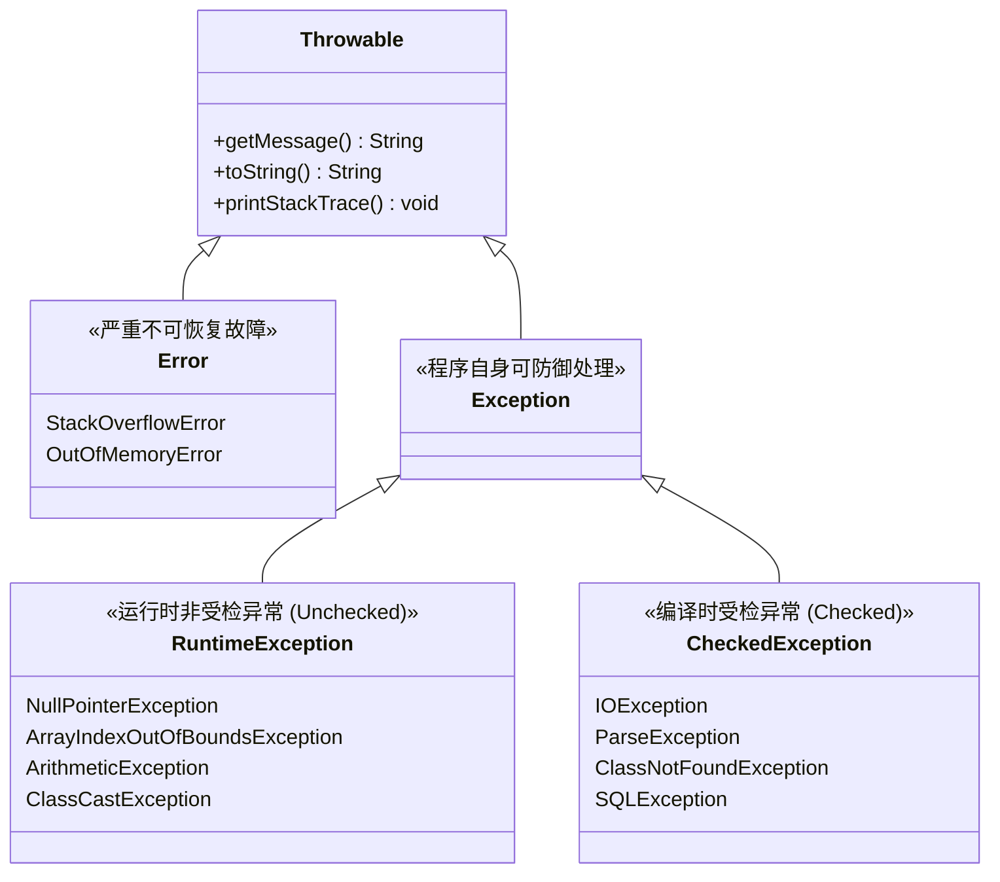
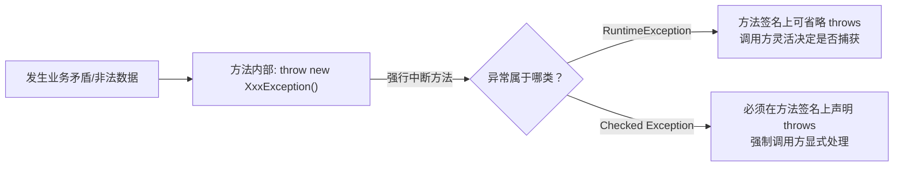

# Java 异常处理机制（Exception Handling）深度精讲

本模块为 Java 异常处理体系的系统化学习与实战总结，配套模块源码均位于当前包下，以 [`Test.java`](Test.java) 为主执行入口。

---

## 1. 模块代码导航

| 模块文件 | 对应课程 | 核心教学内容 |
| :--- | :--- | :--- |
| [`Test.java`](Test.java) | 全课程 | **主入口驱动类**：编排执行 D01 ~ D09 所有异常机制演练 |
| [`D01_ExceptionHierarchy.java`](D01_ExceptionHierarchy.java) | 01-异常体系介绍 | 顶层根类 `Throwable`、`Error`（严重灾难故障）与 `Exception`（可处理异常）的本质界限 |
| [`D02_CompileVsRuntimeException.java`](D02_CompileVsRuntimeException.java) | 02-编译时与运行时异常 | 编译时受检异常（Checked 强校验） vs 运行时非受检异常（Unchecked 逻辑缺陷） |
| [`D03_ExceptionRolesInCode.java`](D03_ExceptionRolesInCode.java) | 03-异常的两个作用 | 作用一：精准追溯错误源头排查 Bug；作用二：阻断非法流程向调用者传递错误信号 |
| [`D04_JvmDefaultExceptionHandler.java`](D04_JvmDefaultExceptionHandler.java) | 04-JVM默认处理方式 | JVM 面对未捕获异常的“两步杀招”：`System.err` 红字打印调用栈 + 立即强制终止线程 |
| [`D05_TryCatchBasics.java`](D05_TryCatchBasics.java) | 05-try...catch捕获 | `try...catch` 拦截语法、夺回程序控制权、保障系统不崩溃继续运行 |
| [`D06_TryCatchSoulQuestionsPart1.java`](D06_TryCatchSoulQuestionsPart1.java) | 06-捕获异常灵魂四问(①②) | 灵魂一问（正常执行全走 try）、灵魂二问（多 catch 顺序：**子类在上、父类在下**、JDK 7 管道合并） |
| [`D07_TryCatchSoulQuestionsPart2.java`](D07_TryCatchSoulQuestionsPart2.java) | 07-捕获异常灵魂四问(③④) | 灵魂三问（类型不匹配等于没抓交给 JVM）、灵魂四问（报错行下方代码全部废止）与 `finally` 资源释放保障 |
| [`D08_ExceptionCommonMethods.java`](D08_ExceptionCommonMethods.java) | 08-异常中的常见方法 | `getMessage()`、`toString()`、`printStackTrace()`（底层 `System.err` 输出与多流缓冲区剖析） |
| [`D09_ThrowAndThrowsModule.java`](D09_ThrowAndThrowsModule.java) | 09-抛出异常机制 | `throw`（方法内扔对象） vs `throws`（方法签名甩锅预警）、自定义业务异常实践 |
| [`exception/AgeOutOfBoundsException.java`](exception/AgeOutOfBoundsException.java) | 自定义异常模型 | 继承自 `RuntimeException` 的领域自定义异常类 |

---

## 2. Java 异常继承体系全景

---

## 3. 编译时异常 vs 运行时异常核心对比

| 评估维度 | 编译时异常（Checked Exception） | 运行时异常（Unchecked Exception） |
| :--- | :--- | :--- |
| **继承基类** | 直接继承 `Exception`（不继承 `RuntimeException`） | 继承自 `RuntimeException` 或其子类 |
| **编译器态度** | **强制性检查**：不写 `try-catch` 或 `throws` 则**编译报错** | **不强制检查**：编译期完全放行，运行触发时才暴露 |
| **产生原因** | 外部不可控环境因素（文件不存在、网络断开、格式错误） | 程序员自身逻辑缺陷（空指针访问、数组下标越界、除以零） |
| **处理理念** | 提前做好防御机制与保底备选方案 | **应在编码阶段通过前置校验修复**，而不是滥用 try-catch 掩盖 Bug |
| **典型代表** | `ParseException`, `IOException`, `SQLException` | `NullPointerException`, `IndexOutOfBoundsException`, `ArithmeticException` |

---

## 4. 捕获异常“灵魂四问”（原课件重点深度解析）

| 灵魂追问 | 权威解答 | 核心机制与原理剖析 |
| :--- | :--- | :--- |
| **灵魂一问：** 如果 `try` 中没有遇到问题，怎么执行？ | **会把 `try` 里面所有的代码全部执行完毕，绝对不会执行 `catch` 里面的代码。** | 程序按顺序执行完 `try` 块的最后一条语句后，自动跳过与之关联的所有 `catch` 块，直接往下执行后续业务代码。 |
| **灵魂二问：** 如果 `try` 中可能会遇到多个问题，怎么执行？ | **会写多个 `catch` 与之对应；父类异常必须写在下面！** | 1. 匹配策略：自上而下逐个比对，一旦匹配到一个 `catch` 即进入执行，其余 `catch` 自动忽略； 2. **顺序铁律**：子类异常在前，父类异常在后！若父类写在上方，子类分支将因多态拦截变成**不可达死代码**，编译器直接报编译错误； 3. **JDK 7+ 语法糖**：同级多异常可通过管道符捕获：`catch (AException \| BException e)`。 |
| **灵魂三问：** 如果 `try` 中遇到的问题没有被捕获，怎么执行？ | **相当于 `try...catch` 白写了，当前异常会交给 JVM 虚拟机处理！** | 若抛出的异常类型与所有的 `catch` 均不匹配，该异常会沿方法调用栈向上穿透。若顶层 `main` 方法也未拦截，最终由 JVM 执行默认两步：**以红色字样打印堆栈信息，并强制杀死当前线程退出程序**。 |
| **灵魂四问：** 如果 `try` 中遇到了问题，那么 `try` 下面的其他代码还会执行吗？ | **不会执行了！** | 当 `try` 中某一代码行触发异常时，该行立即中断并生成异常对象抛出，直接跳转到对应的 `catch` 块。**`try` 块中位于报错语句之后的所有代码将彻底丧失执行机会**（因此重要清理工作务必放入 `finally` 块中）。 |

---

## 5. `throw` 与 `throws` 终极辨析矩阵

| 对比维度 | `throw` 关键字 | `throws` 关键字 |
| :--- | :--- | :--- |
| **编写位置** | 位于【方法体内部】 | 位于【方法形参列表之后、方法体之前（方法签名上）】 |
| **核心含义** | **具体动作**：在代码现场真正实例化并“扔出”一个异常对象 | **风险声明**：向调用方发出预警，“我这里可能会出现这种异常，请做好准备” |
| **后续执行** | 一旦执行，当前方法**立即强行中断**，后续代码绝不执行 | 只是声明，对当前方法内部的代码正常执行无任何负面影响 |
| **后接内容** | 后面只能跟【异常对象实体】（如 `throw new AgeOutOfBoundsException("...")`） | 后面跟的是【异常类名】，可同时声明多个用逗号隔开（如 `throws IOException, ParseException`） |

---

## 6. Throwable 核心方法速查

1. **`e.getMessage()`**：
   - 返回异常发生时携带的简明描述字符串（如 `"/ by zero"` 或 `"Index 10 out of bounds for length 6"`）。
   - 适用于：向客户端前端、界面弹窗展示简短友好的错误提示。
2. **`e.toString()`**：
   - 返回格式：`【全类名: getMessage()】`。
3. **`e.printStackTrace()`**：
   - 在控制台打印最详尽的异常全家桶（包括异常类型、原因、由深到浅的方法调用链路与源码具体行号）。
   - **底层细节**：使用 `System.err`（标准错误输出流）异步输出，控制台呈现红色；
   - 生产环境建议：开发测试排查利器；在企业生产中应统一使用日志门面 `log.error("...", e)` 持久化至磁盘日志，避免控制台吞吐瓶颈。